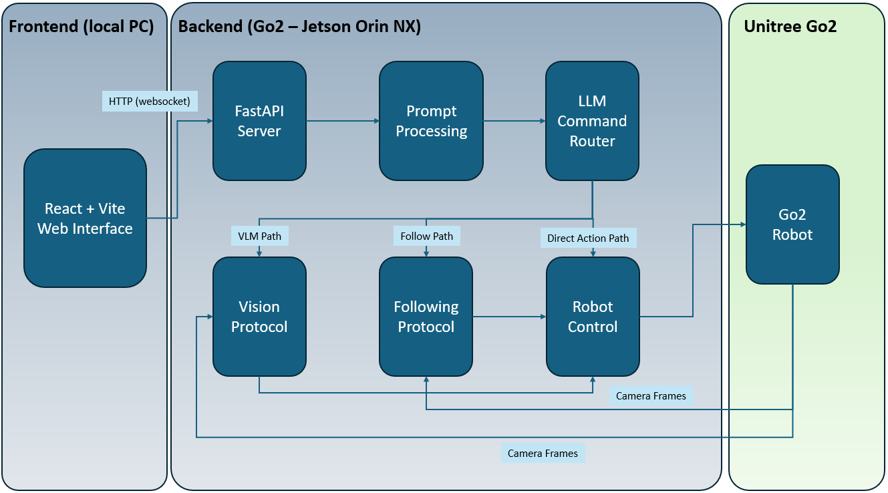

# go2-vlm-agent

An experimental vision-based robotics project for the **Unitree Go2 EDU**, running on an **NVIDIA Jetson Orin NX**. It combines natural-language command routing, camera-based perception, and robot control through a web interface. This project was undertaken for Auckland University of Technology (AUT) AI Acceleration Lab, as part of the Research and Development final-year project.

## Architecture



The React/Vite interface sends commands to a FastAPI/Uvicorn backend. Phi-3, served through Ollama, routes requests to direct robot actions or visual processing. The backend uses the Go2 front-facing camera, YOLO11n for object detection and following, and Unitree SDK2 for action execution. A separate vision-language module supports scene understanding when enabled.

## Core Capabilities

- **Natural-language control:** route commands such as “sit down”, “wave”, and “stop” to robot actions.
- **Object detection:** identify targets in the camera feed, such as a person, bottle, or cup.
- **Target following:** use bounding-box position to centre a target and box size as a proxy for distance, moving forward or backward as needed and stopping within the desired range.
- **Scene understanding:** process visual requests through the vision-language module when enabled.

## Quick Start

These steps assume the project and its dependencies are installed on the appropriate devices. For initial robot and network setup, see [the Go2 setup guide](docs/go2-setup.md).

Connect the development PC to the Go2 network and confirm SSH access to the robot.

### 1. Start Ollama on the robot

In an SSH terminal:

```bash
cd ~/go2-vlm-agent
./start.sh
```

### 2. Start the backend on the robot

In a second SSH terminal:

```bash
cd ~/go2-vlm-agent
python3 -m backend.main
```

The backend manages command routing, camera input, perception, and robot control. Runtime logs appear in this terminal.

### 3. Start the frontend on the development PC

From the local project copy:

```bash
cd ~/go2-vlm-agent/frontend
npx vite --mode robot
```

Keep all three processes running. Open [http://localhost:5173](http://localhost:5173) on the development PC to send commands.

## Environment and Dependencies

Recorded versions from the robot's Jetson environment:

| Component                   | Version                                        |
| --------------------------- | ---------------------------------------------- |
| Ubuntu                      | 20.04.5 LTS                                    |
| Linux kernel / architecture | 5.10.104-tegra / aarch64                       |
| Jetson Linux (L4T)          | R35.3.1                                        |
| Python                      | 3.8.10                                         |
| pip                         | 25.0.1                                         |
| Ollama                      | 0.3.14 (client)                                |
| CUDA toolkit                | 11.4 (V11.4.315)                               |
| PyTorch                     | 2.0.0a0+8aa34602.nv23.03, built with CUDA 11.4 |
| Ultralytics                 | 8.3.228                                        |
| unitree_sdk2py              | 1.0.1                                          |

The application also uses FastAPI, Uvicorn, Pillow, and NumPy in the backend, and React/Vite in the frontend. Their versions were not included in the environment record. CUDA was available to PyTorch in the recorded environment.

## Project Structure

```text
go2-vlm-agent/
├── backend/
│   ├── camera/go2_camera.py           # Robot camera access
│   ├── objectDetection/yolo_engine.py # YOLO perception
│   ├── robotControl/robot_control.py  # Unitree actions
│   ├── utils/
│   │   ├── command_router.py          # Command routing
│   │   └── input_processor.py         # Prompt preprocessing
│   ├── vlm/phi_engine.py              # Vision-language processing
│   ├── decision_logic.py             # Behaviour decisions
│   ├── shared_state.py               # Shared application state
│   ├── server.py                     # Backend API
│   └── main.py                       # Backend entry point
├── frontend/                         # React/Vite interface
├── docs/                             # Setup documentation
├── images/diagram.png                # Architecture diagram
├── testing/                          # Evaluation scripts
├── start.sh                          # Ollama startup
└── README.md
```

## Requirements and Specifications

See the [product requirements and specifications](docs/requirements-and-specifications.md) for hardware, software versions, dependencies, AI models, and runtime requirements.

## Safety

This is an experimental system; behaviours may require tuning. Test movement commands in a clear, open area under supervision, with an emergency stop available.
